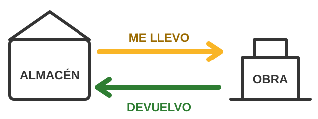
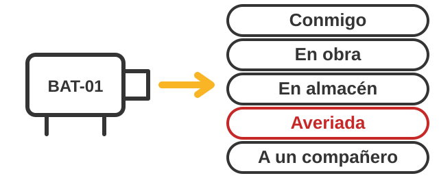
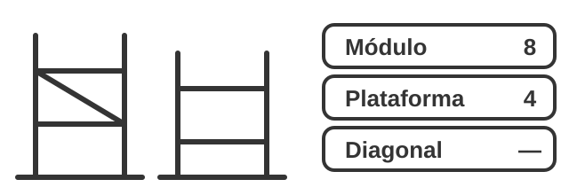
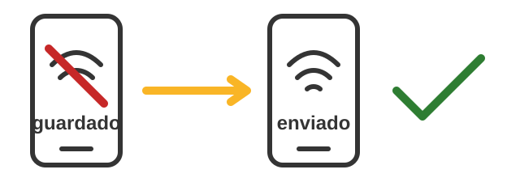

# App SOLERA · guía para el trabajador

Para imprimir y tenerla en la furgoneta. Es lo mismo que la pestaña **Ayuda** de la app (que funciona sin cobertura).

Para entrar: abre el icono **SOLERA** del móvil, elige tu nombre y pon tu PIN.

---

## 1. ME LLEVO y DEVUELVO

1. **ME LLEVO** cuando sacas material del almacén para una obra. **DEVUELVO** cuando lo traes de vuelta.
2. Escribe el material, o toca la cámara y apunta al código de barras del saco o la caja.
3. Pon cuántos con **−** y **+**. Si llevas varias cosas: **+ otra línea**.
4. La obra sale puesta (la última que usaste). Si es otra, escribe el nombre o el nº de tienda.
5. Toca **GUARDAR**. Sale la tarjeta verde y luego el nº de vale (A0012…).

- **¿Lo apuntas por un compañero** que no tiene el móvil? Toca **"Lo apunto por un compañero"** y elige su nombre.
- **¿Te has equivocado?** En **Enviados**, en el vale de hoy, toca **"Me he equivocado"** y di qué está mal. Mateo lo corrige.
- **¿Ha aparecido material que nadie apuntó?** Toca **"¿Ha aparecido material sin albarán?"** y di de dónde ha salido: *sobró de la obra*, *lo dejó Mercadona* o *apareció en el almacén*.

---

## 2. ¿Dónde queda una máquina?

1. Cada vez que una máquina cambia de sitio, díselo a la app: **Herramientas → "¿Dónde queda una máquina?"**.
2. Escribe su número (BAT-01) o toca la cámara y apunta a la pegatina con el QR.
3. Elige dónde se queda: **Conmigo**, **En obra**, **En almacén**, **Averiada** o **A un compañero**. El botón amarillo es lo normal para esa máquina.
4. Si está **averiada**: di qué le pasa y haz una foto. Se deja en QUIQUIRÁ.
5. ¿No tiene número? Toca **"No tiene número → darle uno"**: la app te dice qué número escribirle con rotulador y haces la foto con el número.

---

## 3. Andamios

1. Los andamios no llevan número: se apuntan **por piezas**. Herramientas → **Andamios**.
2. Elige qué haces: **llevar a obra**, **recoger de obra** o **entrada en almacén**.
3. Pon cuántas piezas de cada tipo. Lo que dejes vacío cuenta como 0.
4. Haz **una foto** de todo el montón (obligatoria) y GUARDAR.

---

## 4. Sin cobertura

1. Sin cobertura puedes hacer todo igual: toca GUARDAR y sale **"Guardado en el móvil · se enviará solo"**.
2. Cuando vuelve la cobertura, se envía solo. En **Enviados** ves lo que falta (el numerito rojo de abajo).
3. Antes de ir a un sitio sin cobertura, con cobertura: **Enviados → "Preparar para ir sin cobertura"**.
4. Si sale arriba la **banda amarilla** "no se han podido enviar": toca en ella. Prueba **Reintentar**; si sigue igual, **Avisar a Mateo**.
5. No borres la app ni los datos del navegador si hay algo pendiente de enviar.

---

*Si algo no funciona: haz una captura de pantalla y mándasela a Mateo.*
